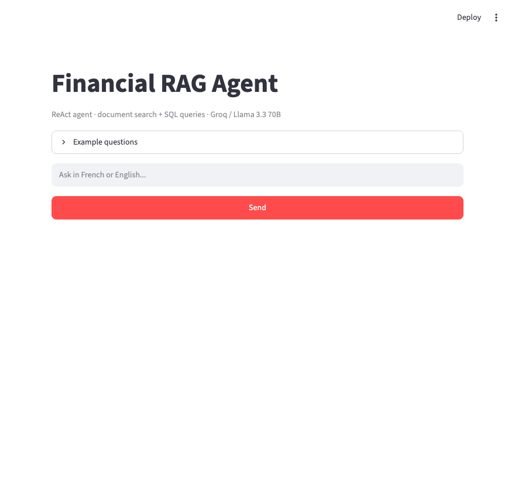

# Financial RAG Agent

An agentic RAG system that answers questions about financial risk data using two tools:

- **Document search (RAG)**: semantic search over indexed reports and methodology docs (ChromaDB + sentence-transformers)
- **SQL queries**: direct queries on a SQLite database of 30,000 scored clients

The agent (ReAct / LangGraph) decides which tool to use based on the question. Answers in French or English.

Documents use [OKF](https://github.com/GoogleCloudPlatform/knowledge-catalog) (Google's Open Knowledge Format). Every answer is also staged as a new OKF note in a governed wiki, and it only joins the trusted corpus once I approve it.



## Knowledge governance: OKF + governed wiki

```
curated OKF docs ──rag_tool──> agent answers ──stage──> generated OKF note (unreviewed)
       ▲                                                          │
       └──────────────── promote() [human gate] ─────────────────┘
```

- OKF: each doc starts with YAML front-matter (`type`, `title`, `tags`, `timestamp`, ...). Ingestion parses it, removes it from the embedded text and stores it as ChromaDB metadata, so citations read `title (type) [tags]` instead of a file path.
- RAG: the agent answers from retrieved chunks and cites them.
- Governed wiki: answers are staged as OKF notes (`status: unreviewed`) in a separate ChromaDB collection, skipping near-duplicates (cosine >= 0.9). The agent never reads that collection. A note reaches the trusted corpus only when I click Promote in the sidebar, so generated text cannot feed back into answers unreviewed.

## Stack

Python · LangChain · LangGraph · ChromaDB · Groq (GPT-OSS 120B) · Streamlit · sentence-transformers · OKF

## Setup

```bash
python -m venv .venv && source .venv/bin/activate
pip install -r requirements.txt
```

Create a `.env` file:
```
GROQ_API_KEY=your_key_here
```

Get a free key at [console.groq.com](https://console.groq.com).

## Usage

```bash
# Index documents (run once)
python ingest.py

# Launch the dashboard
streamlit run app.py
```

## Example questions

- *What is the AUC score for fraud detection?* → RAG on reports
- *Quel est le taux de défaut moyen par décile de risque ?* → SQL on scored clients
- *How many anomalies per education level?* → SQL aggregation
- *Quelle est la méthodologie de scoring ?* → RAG on methodology docs

## Data

The SQL tool connects to the `scored_clients` table from the [spf-risk-scoring](https://github.com/Proftg/spf-risk-scoring) project (30k clients, Isolation Forest scoring).
